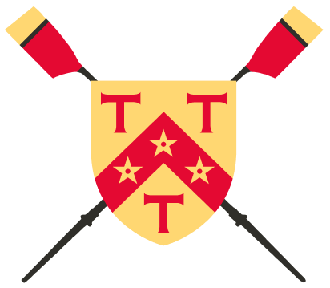

Plan your crew’s next session, or practise finding a boat’s balance.

```{=html}
<a class="boat-game-card rowing-planner-card" href="../sabc/">
  <span class="boat-card-art rowing-planner-art" aria-hidden="true"></span>
  <span class="boat-card-copy"><span class="boat-eyebrow">01 / CREW PLANNING</span><strong>SABC Planner</strong><span>Select your crew and find shared availability.</span><span class="boat-card-link">Open the planner <span aria-hidden="true">↗</span></span></span>
</a>
<a class="boat-game-card" href="../games/balance-the-boat/">
  <span class="boat-card-art" aria-hidden="true">
    <svg viewBox="0 0 480 200" fill="none">
      <path d="M0 148H480M0 168H480M0 188H480" stroke="#a7c7cd" stroke-width="1"/>
      <g transform="rotate(-9 240 135)">
        <path d="M125 124Q240 155 355 124L335 144Q240 167 145 144Z" fill="#ecb94b"/>
        <path d="M125 124Q240 141 355 124" stroke="#fdf7e8" stroke-width="4"/>
        <path d="M233 116V78" stroke="#749ba9" stroke-width="28" stroke-linecap="round"/>
        <circle cx="233" cy="53" r="18" fill="#749ba9"/>
        <path d="M219 88L204 107L250 111" stroke="#749ba9" stroke-width="10" stroke-linecap="round"/>
        <path d="M250 111L83 141" stroke="#173d4d" stroke-width="6" stroke-linecap="round"/>
        <path d="M263 109L237 113" stroke="#edb346" stroke-width="9" stroke-linecap="round"/>
        <path d="M80 141L42 148" stroke="#278d88" stroke-width="18" stroke-linecap="round"/>
      </g>
    </svg>
  </span>
  <span class="boat-card-copy"><span class="boat-eyebrow">02 / GAME</span><strong>GAME: Balance the Boat</strong><span>Learn the balance. Then find your rhythm.</span><span class="boat-card-link">Boat Still &amp; Boat Moving <span aria-hidden="true">↗</span></span></span>
</a>
```
